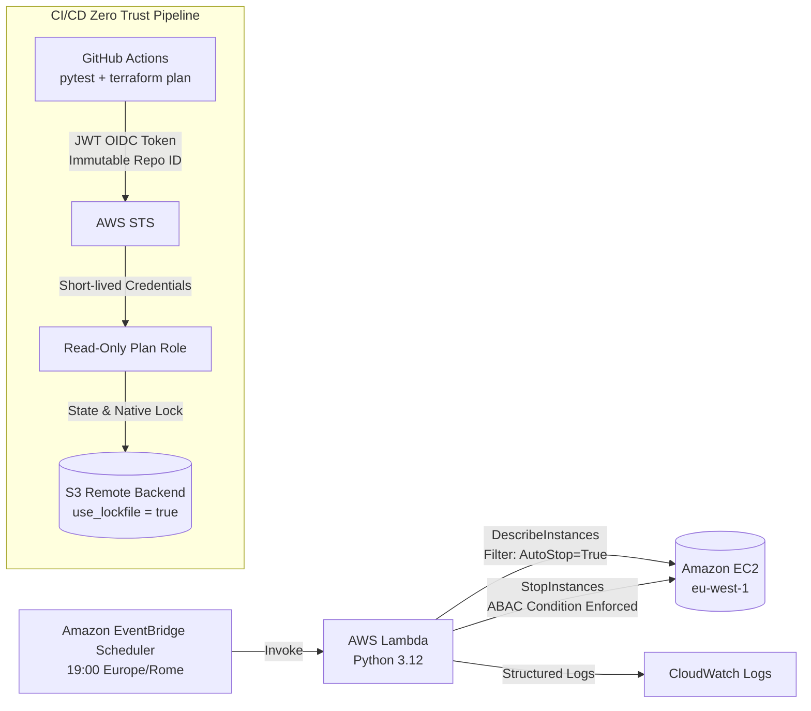

# AWS FinOps EC2 Scheduler (Zero Trust & Fail-Safe Architecture)

[](https://github.com/pythondub/aws-finops-scheduler/actions/workflows/ci.yml)

An automated, serverless AWS FinOps solution designed to eliminate idle EC2 compute costs outside business hours. Built with **Python 3.12 (`boto3`)**, **Terraform**, and **GitHub Actions OIDC**, adhering strictly to **Zero Trust**, **Least Privilege (ABAC)**, and **Fail-Safe** engineering principles.

## Architecture



## Security & Engineering Controls

| Control Domain | Implementation | Risk Mitigated |
| :--- | :--- | :--- |
| **Opt-In & ABAC IAM** | Lambda IAM policy enforces `ec2:ResourceTag/AutoStop = True` via `Condition` block. | Prevents accidental or unauthorized stoppage of production workloads, even if Lambda code is compromised. |
| **Fail-Safe Execution** | `DRY_RUN=true` is enforced by default; AWS evaluates full IAM permissions via `DryRunOperation` without altering instance state. | Eliminates blast radius during testing and sandbox validation. |
| **Keyless CI/CD (OIDC)** | GitHub Actions authenticates via AWS STS `AssumeRoleWithWebIdentity`. No static IAM access keys exist. | Eliminates long-lived credential leakage. |
| **Anti Repo-Jacking** | OIDC Trust Policy binds `sub` claim to immutable GitHub Owner & Repository numeric IDs. | Prevents unauthorized AWS access if the repository or username is renamed/deleted. |
| **State Integrity** | S3 Remote Backend with native state locking (`use_lockfile = true`), AES-256 encryption, and versioning. | Prevents state corruption during concurrent runs without legacy DynamoDB overhead. |
| **Supply Chain Security** | Branch Protection Ruleset (`protect-main`) enforces GPG-signed commits (`Verified`), PR workflow, required CI checks, and blocks force pushes. | Prevents unverified code injection and history tampering. |

## Repository Structure

```text
.
├── .github/workflows/
│   └── ci.yml              # Automated pytest + OIDC terraform fmt/validate/plan
├── src/
│   └── scheduler.py        # Opt-in EC2 stopper Lambda handler (Python 3.12)
├── tests/
│   └── test_scheduler.py   # Isolated unit tests using moto[ec2]
├── terraform/
│   ├── backend.tf          # S3 remote state with native lockfile
│   ├── iam.tf              # ABAC execution roles (Lambda & EventBridge)
│   ├── main.tf             # Lambda function, archive packaging, CloudWatch & EventBridge Scheduler
│   ├── oidc.tf             # Least-privilege GitHub Actions OIDC plan role
│   └── variables.tf        # Configurable parameters (DRY_RUN, region, schedule)
├── pytest.ini              # Deterministic PYTHONPATH configuration for CI/local
├── requirements.txt        # Runtime dependencies
└── requirements-dev.txt    # Testing dependencies (pytest, moto)
```

## Local Verification & Deployment

### 1. Run Unit Tests (Offline with Moto)
```bash
python3 -m venv .venv
source .venv/bin/activate
pip install -r requirements-dev.txt
pytest -v
```

### 2. Deploy Infrastructure (AWS SSO)
Ensure your AWS SSO profile is authenticated (`aws sso login --profile <PROFILE>`) and S3 backend bucket is initialized:
```bash
cd terraform
terraform init
terraform fmt -check -recursive
terraform validate
AWS_PROFILE=<PROFILE> terraform plan
AWS_PROFILE=<PROFILE> terraform apply
```

## Cost Profile

* **AWS Lambda & EventBridge Scheduler:** Operates entirely within AWS Free Tier (`~$0.00/month`).
* **S3 State Backend:** Negligible storage footprint (`<$0.01/month`), zero DynamoDB cost due to Terraform native S3 lockfile support.
